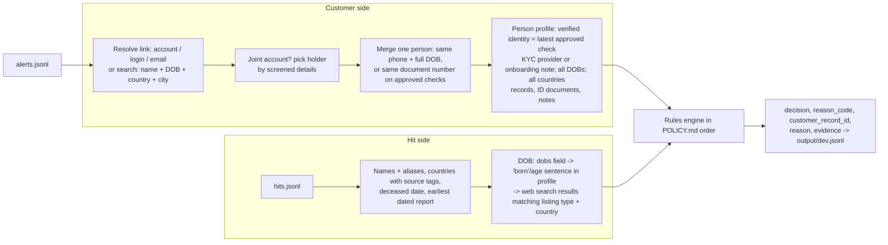

# Same Person or Not? Sanctions / PEP / adverse-media hit adjudication (Track 2)

`system/run <data folder> <output file>` reads the JSON Lines data room and writes one decision per hit:
`DIFFERENT_ENTITY`, `SAME_ENTITY` or `REVIEW`. Each decision carries a policy reason code, the resolved customer record,
a 2–4 sentence reason and the IDs of the records it rests on. It is pure Python 3 standard library, deterministic,
and uses **no language model**.

## Architecture

**Rules engine (fixed order).**
1. Entity type mismatch.
2. Deceased before screening.
3. Too young (under 16), or not yet incorporated, at the earliest dated report.
4. DOB contradiction, which must hold against **every** DOB the bank holds for the person.
5. Location mismatch, with these exceptions that go to REVIEW instead:
   - name and DOB agree;
   - the hit's only country link is a business address (individuals);
   - the countries were once one state.
6. Verified legal-name mismatch, using the head of financial crime's middle rule (below).
7. Confirm: for a person, name + DOB (+ country); for a company, name + country.
8. Otherwise REVIEW / INSUFFICIENT_DATA.

When several people fit an alert, each is decided separately. If they all lead to the same decision, that decision is given with `customer_record_id = AMBIGUOUS`. Otherwise the result is REVIEW / AMBIGUOUS_CUSTOMER_RECORD.

## How the two sides are resolved
- **Customer.** The system follows whatever link the alert carries. With no link (146 of 440 alerts), it searches the customer records:
  - a full or preferred name agreeing with the screened name (policy name rule);
  - a DOB equal in every part both give;
  - the screened country as residence or nationality;
  - the screened city in the record's city or address.

  Joint accounts are narrowed with the same test. Records are merged into one person on phone + full DOB, or on a shared approved document number (transitively). The verified identity is the most recent approved check, either a KYC provider record or a KYC-channel onboarding note, which are parsed with regexes. Rejected and expired checks are ignored.
- **Listed entity.** Names and aliases are normalised: case, accents, brackets, placeholders (NA, TEST, XXX, 0000), company legal forms, `name_variants.json`, joined/split forms, and a 1–2 letter edit tolerance.
  - **Countries** come from countries, nationality, citizenship, address tails and place of birth, keeping each address's tag ([Business], [Residency]…). "International" and "Europe" are dropped.
  - **DOB** is taken from `dobs`; otherwise from a "born …" or age-at-date sentence in the first paragraph of the profile; otherwise from web search results. A search result counts only if it carries the hit's listing phrase (e.g. "a politically exposed person") and a country tied to the hit.
  - **Age sentences** must name the subject (or say he/she). Numbers followed by units are ignored ("40 pounds", "21 West Drive"), and "According to …" news paragraphs are not mined for ages.
  - **Dated reports** are the "According to …; Month d, yyyy:" lines.

## Evidence
Each extracted fact keeps the ID of the record it came from. A decision cites only what decided it:
- **DOB or verified-name clearance:** the identity check or note, plus any search result.
- **Location clearance:** the person's records, the verified check, and every note that placed them in a country.
- **Confirmation:** the records, the DOB source and any search result.
- **Review:** the records tying the customer to the shared country.

On the 50 practice labels, the evidence lists are identical to the reference for 47 of 48 correct decisions.

## Determinism
There is no model, no randomness and no clock dependence. Inputs are processed in sorted order, and ties are broken on IDs. Five consecutive runs produced byte-identical output (same MD5).

## Model and prompts
None. An optional model step for reading free-text ages and dates was considered and deliberately left out. It would only make sense as an extractor, at temperature 0 with cached responses and off by default, feeding facts to the same rules, with any disagreement going to REVIEW.

## Time and cost
About 15–20 seconds for the development set (819 hits, 72k customers) on one CPU core, or about 2 minutes if given only the .xlsx workbook. £0 per run; there are no API calls.

## Three worked cases (from `output/dev.jsonl`)
- **Different entity: H-58A39C** (Timothy Pangelinan Villagomez). The customer's approved KYC check KYC-232AE0 gives DOB 1965-03-28. The hit's only DOB is 1962-09-10: more than 1 year apart, and no other DOB the bank holds agrees. Result: `DIFFERENT_ENTITY / DOB_MISMATCH`, evidence `[KYC-232AE0]`.
- **Same entity: H-4D76E3** (Mohammad Nadeem Ghani). The customer record CUS-970916 says born 1963-12-02. The person also has record CUS-906311 (same phone and DOB), and the most recent approved check, an onboarding note NOTE-4E8A14, verifies 1968-02-17, matching the hit's 1968-02. The countries (Pakistan, UK) and name agree. Result: `SAME_ENTITY / NAME_DOB_LOCATION_MATCH`. Early in the build this hit was wrongly cleared on the record DOB, and that led to the rule "a clearance must hold against every DOB the bank holds".
- **Review: H-B1018D** (Jovanović, Dejan). The customer is tied only to Serbia (CUS-596148, KYC-780296) and the hit only to Montenegro. Literally a location mismatch, but the two were one state, so: `REVIEW / INSUFFICIENT_DATA`, "Escalated, not cleared: … These countries were part of one state, Yugoslavia (and Serbia and Montenegro)… Reviewer: check the dates of the listing's country information, place of birth and nationality…".

## Policy decisions made by the Head of Financial Crime
These are applied on top of POLICY.md, and are always the more cautious reading:
1. **Name + partial DOB confirms** (e.g. H-DFB2B9, DOB 1988-04-28 vs hit 1987/1988): SAME_ENTITY stands.
2. **Location difference never clears a name + DOB match:** REVIEW (H-ADF453).
3. **Single shared name part with the verified legal name (middle rule):** clear only when the shared part is the surname on both sides and both sides have full given names that clearly differ (no variant, initial, prefix/diminutive, joined form or abbreviation link). Otherwise REVIEW with reviewer guidance.
4. **Surnames that are commonly a father's given name** (Arabic, Hausa, Islamic, West African traditions, e.g. Umar, Ahmed, Abubakar, Alhassan, Ibrahim, Yusuf, Suleiman, Bello, Garba, Musa, Ali, Hassan, Hussein, Abdullah): never cleared on verified-name mismatch; REVIEW.
5. **Countries that were once one state** (former Yugoslavia/Serbia & Montenegro/Kosovo, former USSR, Czechoslovakia, Sudan/South Sudan, Ethiopia/Eritrea): REVIEW, not location clearance. Neighbours that were never unified still clear.
6. **A hit whose only country link is a business address** does not support a location clearance (individuals): REVIEW.
7. **Several people fit and all lead to clearance:** clear, with customer AMBIGUOUS.
8. **Ages inside news-report paragraphs are ignored**, so those hits go to review rather than being cleared.
9. **Every country mentioned in the customer's notes counts** towards the customer's country set (fewer location clearances).
10. **H-2808BE stays in REVIEW** (possible name reorder) rather than being tuned to reach 50/50.
11. **Same surname + agreeing DOB:** a different first or given name alone never clears; REVIEW, with guidance that a middle name or known-as name may explain it and that the full legal name must be checked on the ID document. A year-only DOB that agrees counts, and a DOB on file that cannot be read, or that neither agrees nor clearly contradicts, is treated as possibly agreeing (REVIEW). This moved 22 dev clearances to REVIEW, including the labelled H-380854 (labels 49/50 → 48/50, still 0 unsafe).
12. **Shared full name part + agreeing DOB blocks a location clearance** (possible married name or dropped middle name); the 10 country-only clearances this moved to REVIEW stay there.

Every REVIEW created by these calls starts "Escalated, not cleared:" and ends with an explicit "Reviewer: …" instruction.

## UK regulatory framing
- **MLRs 2017:** the output supports customer due diligence and ongoing monitoring (regs 27–28) and enhanced due diligence and PEP obligations (regs 33–35). SAME_ENTITY on a PEP hit feeds the EDD/PEP process; the identity decision is kept separate from risk appetite, as the brief requires.
- **OFSI (Sanctions and Anti-Money Laundering Act 2018 regimes):** a sanctions SAME_ENTITY goes straight to compliance for asset-freeze and reporting decisions. The design minimises the costliest error, clearing a true match: every clearance needs a cited contradiction that holds against all verified identity data.
- **FCA SYSC 6.3 and Financial Crime Guide (FCG 3 and FCG 7):** the system gives documented and consistent screening-alert handling, a recorded rationale and evidence per hit, reproducible results (audit and QA can re-run and get the same answer), escalation with reviewer guidance, and a policy-change log (above) owned by the Head of Financial Crime. Suggested controls:
  - four-eyes review on all REVIEW and SAME_ENTITY results;
  - periodic QA sampling of clearances by type, especially NAME_MISMATCH_VERIFIED and LOCATION_MISMATCH;
  - re-validation when POLICY.md or the screening lists change.

## Robustness (hardening round)
The unseen set may be written differently from the development set, so the system is built to fail safe: when it is unsure, the hit goes to REVIEW and is never cleared.
- **Fail-safe parsing:**
  - A date that cannot be read with certainty is treated as unknown. This covers 2-digit years, impossible dates such as 31/02, and free-text dates.
  - A day/month order that could go either way (03/04/1980) keeps only the year when the convention is not certain. Hit-side dates always work this way, because listings mix dd/mm and mm/dd. On the customer side, dd/mm is used only if no unmistakably month-first date appears anywhere in the customer data.
  - A date of birth that is present but unreadable blocks DOB and temporal clearances. When the names agree, it also blocks a location clearance, because a name + DOB match cannot be ruled out.
  - Countries are matched against a shipped ISO table (`countries.json`, 250 countries with codes, names and demonyms). Anything unrecognised is flagged as unknown and blocks a location clearance; it is never treated as a "different" country.
- **Same person, unclear link:** records that share the customer's phone number but were not merged only because a DOB is partial or unreadable block any clearance.
- **Independent second check:** every DIFFERENT_ENTITY is re-derived from the raw tables by a separate verifier (`second_check`). It covers type, death date, earliest dated report, every DOB pair, the country sets with the former-state, business-address and name+DOB exceptions, and every approved verified name. If the verifier cannot reproduce the contradiction, the hit is downgraded to REVIEW, and the reason says so. On the development set it reproduces every clearance.
- **Tolerant loader:**
  - Reads UTF-8 with a BOM; encoding errors are replaced.
  - Skips bad JSON lines and non-object lines, with a warning.
  - Normalises field names (case, spaces, hyphens) and maps common variants (e.g. `date_of_birth`, `dates_of_birth`, `aka`, `hits`, `account_id`, `notes`). An alias never overwrites a real field.
  - Accepts lists, objects or "; "-strings.
  - Handles missing files and a missing `name_variants.json`.
- **Crash-proofing:**
  - Each alert and hit is decided inside its own error guard, so a failure gives REVIEW / INSUFFICIENT_DATA with a reason saying the automated review could not complete.
  - Every hit in `hits.jsonl` gets exactly one output line, including hits whose alert is missing.
  - A run takes about 10–15 seconds, well inside the 30-minute limit.
- **Perturbation stress test:** `stress_test.py <data folder>` rewrites the data in 21 ways and counts flips against the clean run. An unsafe flip is a hit that becomes DIFFERENT_ENTITY when it was not before. The perturbations are:
  - dates in long, US, slashed, dotted, 2-digit, month-first and year-only forms;
  - name order;
  - added or stripped diacritics;
  - transliteration variants;
  - ISO-2, ISO-3 and upper-case countries;
  - nulled non-identity fields;
  - case and whitespace noise;
  - extra fields and renamed fields;
  - lists instead of strings;
  - junk lines with a BOM;
  - all of these combined.

  The first run found 25 unsafe flips with three root causes. All three are fixed, and the final result is **0 unsafe flips**. Losing information only moves hits to REVIEW (e.g. 2-digit years in every table: 264 clearances become REVIEW, none appear).

## Input formats (the official schema is not published)
The organisers test on files we have not seen, so `loader.py` does not assume one exact layout:
- **Files:** JSON Lines, a JSON array (or `{"data": [...]}`), one JSON object holding several tables, CSV/TSV (any of `, ; tab |`), or an `.xlsx` workbook, read with the standard library only. That covers one table per file, one sheet per table, and title rows above the header. Tables are found by name up to two folders down (`alerts.jsonl`, `Alerts.csv`, `dev_alerts.json`, a "KYC checks" sheet).
- **Fields:** case, spaces, hyphens and camelCase are ignored, and about 350 common synonyms are mapped (e.g. `dateOfBirth`, `birth_date` → `dob`; `legalName` → `full_name`; `type` → `entity_type`; `status`/`outcome` → `result`). Nested objects are flattened. Lists and "; "-strings both work. Dates may be ISO, written out, slashed, Excel serials or timestamps.
- **Alerts and hits:** hits may be separate rows, nested inside their alert, or flat hit rows that carry the alert's fields. In the last case the alerts are rebuilt. Ids are kept exactly as given.
- **Fail-safe:** if a table or a field that clearances depend on cannot be found, or check results use unknown words, the run still answers every hit but **clears nothing**. Each would-be clearance becomes REVIEW with the reason. Unknown entity types count as unknown. Unmapped fields are listed on stderr.
- **Proof:** `schema_fuzz.py <data folder>` rewrites the data in 8 shapes. The first six (renamed/camelCase, CSV, shuffled JSON arrays with extra fields, nested hits, flat joined rows, odd dates with optional fields missing) gave **identical decisions, 819/819**. The two degraded shapes (a key field missing, unknown check results) gave no crashes and no new clearances; their hits moved only towards REVIEW. In every shape there were 0 unsafe clearances against the labels. The raw workbook on its own also gives output identical to the JSONL run.

## Three late safeguards
- **Attacker test (`adversary.py <data folder>`):** every hit we do not clear (421, of which 355 are plausible true matches) is rewritten the way a real match could look elsewhere. The rewrites are transliteration/romanisation variants, swapped order, a dropped middle name, a married surname, US date order, a year-only DOB, a one-letter typo, a former-state/demonym/ISO country, stripped accents, and hyphen/space changes: 3,649 rewrites in all. Before the fixes, 24 rewrites of plausible true matches were cleared; after them, 2. The fixes:
  - A dd/mm vs mm/dd date counts as a contradiction only if both readings contradict, and as agreement if either agrees.
  - Clearances are blocked when names are linked by romanisation, a letter swap or a short-name typo.
  - A shared name part plus an agreeing DOB blocks a location clearance (possible married name or dropped middle name).
  - Web search results are matched on normalised names.

  - Same surname plus an agreeing DOB: a different given name alone no longer clears (policy 11).

  The 2 that remain (H-338C9D, H-38019A) are a listing with no DOB at all where the customer's given name is dropped from the listed name. Closing them would mean never clearing a shared surname when the list gives no DOB, which would move 19 more dev clearances (one labelled different person) and overturn policy 3; left for the Head of Financial Crime.
- **Explain or escalate:** every clearance and match is turned into one sentence stating the field, our value, the list's value and the trusted source (set `SCREEN_EXPLAIN=<file>` to write them). A clearance that cannot be stated that way, or that cites an ID not in the data, is downgraded to REVIEW. On dev all 543 decisions could be stated, so none were downgraded.
- **Many-to-many context:** the system counts how many screened customers each listed name hit, and how many listed names each customer hit. REVIEW reasons get a short note when a name is common (114 reviews on dev). This is never used to clear.

## Limitations
- **Free text:** extraction is regex-based and tuned on the development set's wording. New phrasings of ages, dates and residence notes on the unseen set will fall back to REVIEW (safe, but costs points).
- **No hit DOB:** 548 hits have no date of birth from any source and depend on other facts.
- **Former-state rule ignores dates:** it fires on shared former-state membership regardless of the date of the listing's information.
- **Note countries:** these are detected by country-name mentions, so any mention counts. This is conservative.

## Data caveat
We did not have the official `dev/` JSONL folder during the build, and the organisers keep it and `validate.py` private for ranking. `dev/` was exported from the read-only workbook, with the file names from the brief and fields equal to the workbook columns. List fields were split on "; ", and the workbook cuts long text at 32,000 characters (2 hits). The loader accepts lists or "; "-separated strings. Results must be re-run and re-checked against the official data room and `validate.py` before submission. `validate_local.py` is a stand-in that implements the brief's cost matrix.

## Files
- `run`: entry point.
- `screen.py`: all logic.
- `validate_local.py`: schema check and practice-label scorer.
- `countries.json`: ISO country table (codes, names, demonyms) used for country matching; plain data.
- `stress_test.py`: perturbation stress test (needs a data folder; standard library only).
- `loader.py`: format-tolerant input loader (JSONL/JSON/CSV/xlsx, field synonyms, nesting).
- `schema_fuzz.py`: input-format fuzz test (needs a data folder).
- `demo`, `demo.py`: three-case walkthrough for judges (`system/demo <data folder>`).
- `adversary.py`: adversarial attacker test (needs a data folder).
- `tests/`: 59 tests (`python3 -m unittest discover -s system/tests -v`): 19 rule tests, 17 robustness tests, 12 format tests and 11 safeguard tests.
- `screen_round1.py`: the round-1 baseline, kept for comparison.
