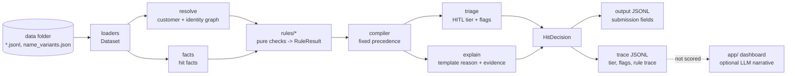

# Architecture

## Pipeline

Per hit: resolve gives 0..n persons; rules run once per person; `compile_person` decides per person; `combine_persons` applies SOP principle 3; any exception becomes REVIEW via `pipeline.fallback`.

## Modules

| File | Purpose | Area | Status |
|---|---|---|---|
| `system/run` | scored entry point (`run <data> <out>`) | infra | implemented |
| `system/screen.py`, `screening/cli.py` | CLI: run / explain / eval / repro / summary | engine | implemented |
| `screening/contracts.py` | enums, input records, RuleResult, HitDecision | engine | implemented |
| `screening/loaders.py` | read data folder, index by ID | data | implemented |
| `screening/resolve.py` | customer resolution (SOP 2-4) | engine | partial: links, KYC, notes; TODO unlinked search, candidate filtering, identity graph |
| `screening/facts.py` | hit facts (SOP 5) | engine | partial: fields; TODO profile-note DOBs, dated reports, search results |
| `screening/normalize/names.py` | name parts, matching (SOP 8) | data | partial: tokenising; TODO matcher |
| `screening/normalize/dates.py` | partial dates | data | partial: ISO, year, month-name; TODO slash formats |
| `screening/normalize/countries.py` | canonical countries | data | stub |
| `screening/rules/entity_type.py` | P6 type | rules | implemented (reference) |
| `screening/rules/deceased.py` | P6 date of death | rules | stub (abstains) |
| `screening/rules/temporal.py` | P6 too young / not incorporated | rules | stub (abstains) |
| `screening/rules/dob.py` | P6 DOB + P7 agreement | rules | stub (abstains) |
| `screening/rules/name.py` | P6 name + P8 | rules | stub (abstains) |
| `screening/rules/location.py` | P6 location + country agreement | rules | stub (abstains) |
| `screening/compiler.py` | rule results -> decision | engine | implemented |
| `screening/triage.py` | HITL tier + weak flags | engine | implemented |
| `screening/explain.py` | template reason, evidence IDs | engine | implemented |
| `screening/evaluate.py` | organiser-style cost scoring | engine | implemented |
| `screening/pipeline.py` | orchestration + error safety net | engine | implemented |
| `tools/import_xlsx.py` | workbook -> JSONL stopgap | data | implemented |
| `tools/task.py`, `tools/bootstrap_github.py` | coordination | infra | in progress |
| `app/` | FastAPI + Vite React dashboard | dashboard | planned |

A stub rule returns `[]`: with no contradiction and no agreement the compiler answers REVIEW, which is safe.

## Contracts (summary)

- **Decision**: `DIFFERENT_ENTITY`, `SAME_ENTITY`, `REVIEW`. **ReasonCode** must belong to its decision (`REASONS_BY_DECISION`).
- **RuleResult**: `rule_id` (e.g. `P6.dob`), `facet`, `signal` (contradiction / agreement / neutral), `reason`, `summary`, `evidence`, `weak`, `weak_why`.
- **HitDecision**: scored fields (`hit_id, alert_id, decision, reason_code, customer_record_id, reason, evidence`) + unscored `tier`, `flags`, `trace`. `submission()` emits exactly the scored fields in fixed order.
- Input records keep raw values; unknown columns go to `extra` so a new field in the unseen set never crashes.

## Compiler precedence

1. Any contradiction -> DIFFERENT_ENTITY, by priority: type, deceased, temporal, DOB, name, location. Exception: location-only contradiction while name and DOB agree -> REVIEW.
2. Person: name + DOB agree -> SAME (`NAME_DOB_LOCATION_MATCH` if a country agrees, else `NAME_DOB_MATCH`). Company: name + country -> `NAME_LOCATION_MATCH`.
3. Otherwise REVIEW / `INSUFFICIENT_DATA`.
4. Several persons: same decision -> keep it with `AMBIGUOUS`; different -> REVIEW / `AMBIGUOUS_CUSTOMER_RECORD`.

## Determinism guarantees

- Stdlib only; no network, no LLM, no randomness, no clock in decisions (runtime is only reported).
- Files read in file order; every listing sorted by ID; hits processed in sorted ID order.
- Reason text from templates; evidence sorted and de-duplicated.
- Output written with fixed key order and `\n` line endings.
- `screen repro --runs 5` runs fresh processes with different `PYTHONHASHSEED` and checks byte identity.

## Safety guarantees

- Clear only on an explicit contradiction (SOP 6); missing facts never contradict.
- Location alone never clears a name+DOB agreement.
- Exceptions anywhere in a hit -> REVIEW with `ENGINE_ERROR:*` flag.
- `screen eval` exits 1 on any unsafe clearance; PRs that introduce one are not merged.
- Automated decisions on weak evidence go to BORDERLINE (see [HITL.md](HITL.md)).
