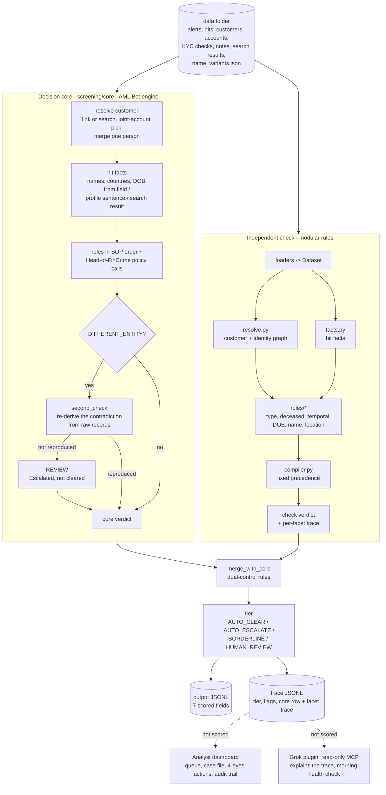

# Architecture

Two independent deterministic engines read the same data folder. The **decision core** decides; the
**independent check** re-decides each hit from its own code and can only make the result more cautious.
A fixed merge step and a tier step turn the two opinions into one scored line plus a review route.

## Overview

Nothing to the right of the dotted lines can change a decision. Grok (via OpenRouter) and the dashboard read the
trace; neither writes to the output or the data folder.

## The two engines

| | Decision core | Independent check |
|---|---|---|
| Code | `system/screening/core/aml_engine.py` (verbatim copy of `contrib/aml-bot/engine/screen.py`) | `system/screening/{resolve,facts,rules/*,compiler}.py` |
| Author | teammate **akhackathon222** (AML Bot), with Head of Financial Crime policy calls | the rest of the team, one file per SOP facet |
| Role | authoritative decision, reason code, customer, reason text, evidence | second opinion; per-facet trace for the dashboard |
| Own safety net | `second_check` re-derives every clearance from raw tables, else REVIEW | compiler clears only on an explicit contradiction; location alone never beats name + DOB |
| Failure | per-alert / per-hit guard -> REVIEW / INSUFFICIENT_DATA | exception -> `CHECK_ERROR:*` flag; the core still answers |

The two engines share no code: separate loaders, resolvers, date/name/country normalisers and rules. A bug in one
is unlikely to repeat in the other, which is the point of dual control.

`SCREEN_ENGINE=core|check|combined` (default `combined`) runs one engine alone, for rule work and comparison.

## Merge rules (`compiler.merge_with_core`)

| Core says | Check says | Result | Flag | Tier |
|---|---|---|---|---|
| X | X (agree) | X | - | AUTO_CLEAR / AUTO_ESCALATE / HUMAN_REVIEW |
| DIFFERENT_ENTITY | SAME_ENTITY (name + DOB agree) | **REVIEW** / INSUFFICIENT_DATA, evidence of both | `ENGINES_CONFLICT` | HUMAN_REVIEW |
| DIFFERENT or SAME | any other disagreement (usually REVIEW) | core decision stands | `ENGINES_DISAGREE` | BORDERLINE (4-eyes) |
| REVIEW | DIFFERENT or SAME | REVIEW | `ENGINES_DISAGREE` | HUMAN_REVIEW |
| no answer | DIFFERENT_ENTITY | **REVIEW** (never clear on the check alone) | `CORE_MISSING` | HUMAN_REVIEW |
| REVIEW, reason starts "Escalated, not cleared" (policy call or `second_check`) | any | REVIEW, with the core's "Reviewer: ..." guidance | `ESCALATED_BY_POLICY` | HUMAN_REVIEW |

Then the tier: REVIEW -> HUMAN_REVIEW; an automated decision carrying a weak flag (`ENGINES_DISAGREE`,
`DOB_FROM_SEARCH_RESULT`, `NAME_FUZZY_MATCH`, `NAME_FROM_SCREENED_ONLY`, `COUNTRY_FROM_SCREENED_ONLY`,
`NO_CUSTOMER_RECORD`) -> BORDERLINE; otherwise AUTO_CLEAR (DIFFERENT) or AUTO_ESCALATE (SAME).

The merge can turn a clear into REVIEW; it can never turn REVIEW or SAME into a clear.

## Modules

| File | Purpose |
|---|---|
| `system/run` | scored entry point (`run <data> <out>`), bash wrapper around `screen.py run` |
| `system/screen.py`, `screening/cli.py` | CLI: run / explain / eval / repro / summary |
| `screening/pipeline.py` | per-hit orchestration, engine selection, exception -> REVIEW |
| `screening/core/__init__.py` | runs the core in-process (mirrors its `main()` loop incl. `second_check`), caches by hit id |
| `screening/core/aml_engine.py`, `countries.json` | the decision core (verbatim) and its ISO country table |
| `screening/contracts.py` | enums, input records, `RuleResult`, `HitDecision` (shared contract) |
| `screening/loaders.py` | read the data folder, index by ID, keep unknown columns in `extra` |
| `screening/resolve.py`, `identity.py` | check side: customer resolution and identity graph (SOP 2-4) |
| `screening/facts.py` | check side: hit facts (SOP 5) |
| `screening/normalize/{names,dates,countries}.py` | check side: name parts and matching, partial dates, canonical countries |
| `screening/rules/*.py` | check side: one pure check per facet (`P6.type`, `P6.deceased`, `P6.time`, `P6.dob`, `P6.name`, `P6.location`) |
| `screening/compiler.py` | check precedence (`compile_person`, `combine_persons`) and `merge_with_core` |
| `screening/triage.py` | check-side weak flags and tier |
| `screening/explain.py` | check-side template reason and evidence IDs |
| `screening/evaluate.py` | organiser-style cost scoring against practice labels |
| `app/` | FastAPI + React analyst dashboard (not scored) |
| `.grok/plugins/fincrim-screening/` | Grok plugin: read-only MCP tools over the engine (not scored) |
| `tools/` | task coordination, morning health-check run |

## Contracts (summary)

- **Decision**: `DIFFERENT_ENTITY`, `SAME_ENTITY`, `REVIEW`. **ReasonCode** must belong to its decision
  (`REASONS_BY_DECISION`); an invalid pair from the core is coerced to REVIEW / INSUFFICIENT_DATA.
- **RuleResult**: `rule_id` (e.g. `P6.dob`, or `CORE.aml` for the core's verdict row), `facet`, `signal`
  (contradiction / agreement / neutral), `reason`, `summary`, `evidence`, `weak`, `weak_why`.
- **HitDecision**: scored fields (`hit_id, alert_id, decision, reason_code, customer_record_id, reason, evidence`)
  plus unscored `tier`, `flags`, `trace`. `submission()` emits exactly the scored fields in fixed order.

## Check-side compiler precedence

1. Any contradiction -> DIFFERENT_ENTITY, by priority: type, deceased, temporal, DOB, name, location.
   Exception: location-only contradiction while name and DOB agree -> REVIEW.
2. Person: name + DOB agree -> SAME (`NAME_DOB_LOCATION_MATCH` if a country agrees, else `NAME_DOB_MATCH`).
   Company: name + country -> `NAME_LOCATION_MATCH`.
3. Otherwise REVIEW / `INSUFFICIENT_DATA`.
4. Several persons: same decision -> keep it with customer `AMBIGUOUS`; different -> REVIEW / `AMBIGUOUS_CUSTOMER_RECORD`.

## Determinism guarantees

- Standard library only; no network, no LLM, no randomness, no clock in decisions (runtime is only reported).
- Both engines process alerts and hits in sorted ID order and break ties on IDs.
- Reason text from templates; evidence de-duplicated in a fixed order.
- Output written with fixed key order and `\n` line endings.
- `screen repro --runs 5` runs fresh processes with different `PYTHONHASHSEED` and checks SHA-256 identity.

## Safety guarantees

- A clearance needs: the core's contradiction, the core's `second_check` reproducing it, and the independent check
  not confirming the match.
- Missing or unreadable facts never contradict; unknown countries and ambiguous dates block clearances.
- Exceptions anywhere in a hit -> REVIEW with an `ENGINE_ERROR:*` / `CHECK_ERROR:*` / `CORE_MISSING` flag.
- `screen eval` exits 1 on any unsafe clearance; PRs that introduce one are not merged.
