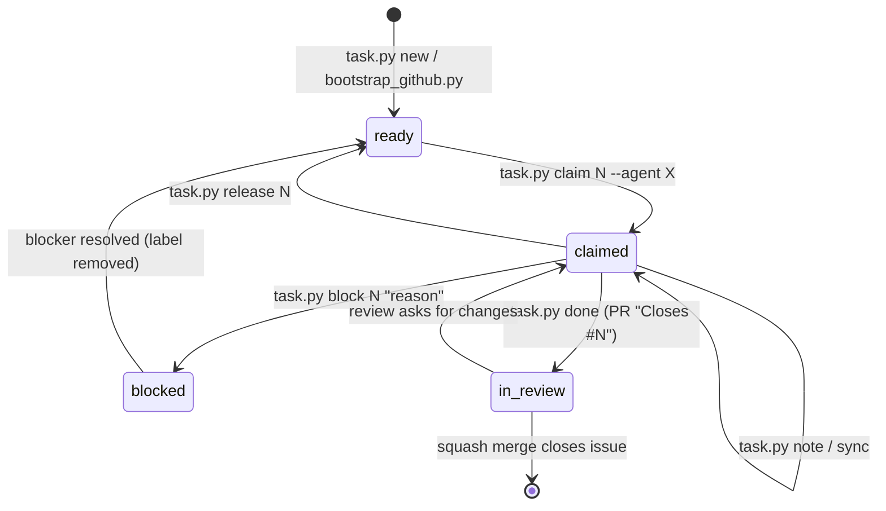

# Collaboration protocol

Short version lives in [AGENTS.md](../AGENTS.md). This is the full protocol for humans and agents (Claude Code, Grok Build, Cursor, Codex) working in parallel for one day.

## Issue lifecycle



Labels carry the state: `status:{ready,claimed,in-review,blocked}`, plus `area:*`, `agent:*`, `priority:{p0,p1,p2}`, `contract-change`.

## Claiming

- Only claim `status:ready` issues. `task.py claim` sets `status:claimed`, `agent:<you>`, assigns you, and creates branch `<N>-<slug>`.
- **Race rule:** if two claims collide, the first claim comment on the issue wins. The loser runs `task.py release N` and picks another.
- One active claim per agent session. Finish or release before claiming again.
- A claim with no commit or note for 90 minutes may be released by anyone (leave a comment).
- Priority order: `p0` before `p1` before `p2`; within a priority, lowest issue number first.

## Branches and PRs

| Rule | Detail |
|---|---|
| Branch name | `<issue#>-<slug>`, e.g. `12-dob-rule` |
| Scope | one issue per branch, one PR per branch |
| PR body | `Closes #N`, what changed, eval numbers before/after, risks |
| Base | always `main`; run `task.py sync` (rebase) before `done` |
| Draft | `task.py done --draft` when unfinished; mark ready when green |
| Never | force-push `main`, commit data/keys, mix unrelated changes |

## Review and merge

- **Any teammate may merge a green PR.** Green = tests pass, `eval` exits 0 (0 unsafe clearances), `repro` byte-identical, no data in diff.
- **Squash merge** only. Delete the branch after merge.
- Rule PRs: run the `sop-reviewer` subagent (`.claude/agents/sop-reviewer.md`) and paste its verdict in the PR.
- A PR that raises unsafe clearances is never merged, even if total score goes up.
- Reviewers check: stays in scope, stdlib-only in `system/`, deterministic, reasons cite the decisive facts.

## Contract changes

`system/screening/contracts.py` is the shared interface.

1. Open or update an issue describing the change and who is affected (which modules / areas).
2. Label the PR `contract-change`; keep it small and merge it fast.
3. Additive changes (new optional field, new enum member) are preferred. Renames need every caller fixed in the same PR.
4. After merge, post in each affected open issue: "contract changed in #PR, run `task.py sync`".

## Handoff notes

Use `task.py note "..."` (an issue comment) whenever you stop:

```
Done: DOB agreement + contradiction, 14 tests
Left: ages-at-date from profile notes (facts.py)
Eval: decision score 0.41 -> 0.47, unsafe 0
Next: python system/screen.py eval --data data/dev -v | grep DOB
```

Then `task.py done --draft` (keep PR) or `task.py release` (give it back). The next agent reads issue comments before coding.

## Grok Bot morning run

A scheduled Grok Build run checks `main` each morning. It never edits code.

1. Runs `summary`, `eval`, `repro` with `--json` (see `.claude/skills/screening-cli`).
2. Opens or updates the issue **"Morning run YYYY-MM-DD"** with a short markdown report: hits, decision/tier counts, decision score, unsafe clearances, reproducibility, runtime.
3. For each regression (unsafe clearance, non-identical repro, score drop, crash) files `python tools/task.py new "<regression>" --area engine --priority p0`.

## Avoiding conflicts

- One file per rule / normaliser; stay in yours.
- Learnings: a new file `docs/learnings/<YYYY-MM-DD>-<slug>.md` each time (format in `docs/learnings/README.md`). Never edit a shared log.
- `output/dev.jsonl` is regenerated only by the release step, not in feature PRs.
- `pyproject.toml`, `uv.lock`, `compiler.py` precedence, `contracts.py`: only via an issue that names them.
- No drive-by reformatting.
