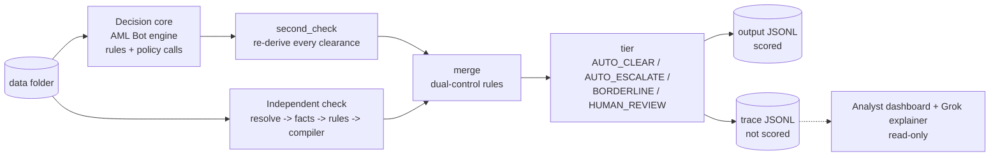

# Same person or not? Screening-hit adjudication

`system/run <data folder> <output file>` reads the data room and writes one JSON line per screening hit:

```
hit_id, alert_id, decision, reason_code, customer_record_id, reason, evidence
```

`decision` is `DIFFERENT_ENTITY`, `SAME_ENTITY` or `REVIEW`. Python 3 standard library only, offline, reads only
the folder it is given, and **no language model in the decision path**.

## At a glance (dev set, 819 hits, 50 practice labels)

| | |
|---|---|
| Decision score (cost saved vs all-REVIEW) | **0.9722** (49 of 50 correct) |
| Unsafe clearances (a true SAME/REVIEW cleared) | **0** |
| Reason code / customer id on correct decisions | 1.0 / 1.0 |
| Evidence precision / recall | 1.0 / 0.99 |
| Review rate on labelled hits | 0.22 |
| Decisions (all 819) | 430 DIFFERENT_ENTITY, 123 SAME_ENTITY, 266 REVIEW |
| Review tiers (all 819) | 397 AUTO_CLEAR, 98 AUTO_ESCALATE, 58 BORDERLINE, 266 HUMAN_REVIEW |
| Time per run | ~75 s on one CPU core (72k customer records) |
| Cost per run | £0 (no API calls) |
| Reproducibility | 5 fresh runs, different hash seeds: byte-identical (see [Runs stay identical](#how-runs-stay-identical)) |

The one miss (H-2808BE) is deliberate: the Head of Financial Crime chose REVIEW over tuning a rule to the label (a
possible name reorder). It costs a review, not a clearance.

## Who built what

- **Decision core**: the AML Bot engine by teammate **akhackathon222** (`contrib/aml-bot/`, copied verbatim into
  `system/screening/core/aml_engine.py`). Its rules follow the SOP order, carry nine policy calls made by the Head of
  Financial Crime, and include its own `second_check` that re-derives every clearance from the raw records.
- **Independent check**: the team's modular rule engine (resolve -> facts -> one rule per SOP facet -> compiler),
  written separately with its own loaders and normalisers.
- **Dual control**: `compiler.merge_with_core` combines the two and assigns a review tier.

## Architecture



Full diagram, module table and merge table: [docs/ARCHITECTURE.md](../docs/ARCHITECTURE.md).

**Merge rules (dual control).** The merge can only make a result more cautious.

| Core | Check | Output | Tier |
|---|---|---|---|
| agree | agree | that decision | AUTO_CLEAR / AUTO_ESCALATE / HUMAN_REVIEW |
| clears (DIFFERENT) | confirms (name + DOB agree) | **REVIEW**, flag `ENGINES_CONFLICT` | HUMAN_REVIEW |
| any other disagreement | | core decision, flag `ENGINES_DISAGREE` | BORDERLINE (4-eyes) unless REVIEW |
| no answer | clears | **REVIEW**, flag `CORE_MISSING` | HUMAN_REVIEW |

Automated decisions resting on a weak fact (DOB only from a web search result, fuzzy name match, no customer record)
also go to BORDERLINE. What each tier means for a reviewer: [docs/HITL.md](../docs/HITL.md).

## How the customer side is resolved

1. **Follow the alert's link** (account reference, login handle or email) to the customer records.
2. **No link?** Search customer records whose name, DOB, country and city all fit the screened details.
3. **Joint account?** Keep only the holder(s) who fit the screened details.
4. **Merge one person** across records: same phone + full DOB, or the same document number on approved checks (transitively).
5. **Verified identity** = the most recent *approved* identity check (KYC provider record or KYC-channel onboarding
   note). It outranks the customer record and the screened name. Rejected and expired checks are ignored.
6. **Several people still fit?** Decide each. All agree -> that decision with customer `AMBIGUOUS`; otherwise
   REVIEW / `AMBIGUOUS_CUSTOMER_RECORD`.

## How the hit side is resolved

- **Names and aliases**, normalised for case, accents, brackets, placeholders, legal forms, `name_variants.json`,
  joined/split forms and a small edit tolerance.
- **Countries** from countries, nationality, citizenship, address tails (keeping tags such as *Business*), place of birth.
- **DOB** from the `dobs` field; else a "born ..." / age-at-date sentence about the subject in the profile; else a web
  search result that names the hit's listing type and a country tied to the hit.
- **Date of death** and **earliest dated report** for the time checks (deceased, too young, not yet incorporated).

## Decision logic

1. **Clear (DIFFERENT_ENTITY)** only on a cited contradiction, in SOP order: entity type, deceased, too young / not
   incorporated, DOB (must contradict *every* DOB the bank holds), location, verified legal name.
2. **Location never clears a name + DOB match**; former single states (Yugoslavia, USSR, Czechoslovakia,
   Sudan/South Sudan, Ethiopia/Eritrea) and business-address-only links go to REVIEW.
3. **Confirm (SAME_ENTITY)**: person -> name + DOB (+ country for `NAME_DOB_LOCATION_MATCH`); company -> name + country.
4. **Otherwise REVIEW.** A missing fact is never a contradiction. Policy escalations start "Escalated, not cleared:"
   and end with a "Reviewer: ..." instruction.

## How evidence is represented

| Field | Content |
|---|---|
| `reason` | 2-4 plain sentences naming the decisive facts and their record IDs |
| `evidence` | only the IDs that decided it: KYC check / note for a DOB or name clearance; records, check and notes placing the customer in a country for a location clearance; records, DOB source and any search result for a confirmation |
| trace (`--trace FILE`, `screen explain`) | the core's verdict (`CORE.aml`) plus every check result: `rule_id` (SOP clause, e.g. `P6.dob`), signal, one-line summary, evidence IDs, weak flag; tier and flags |

## How runs stay identical

- No randomness, network, clock or model in decisions; standard library only.
- Alerts and hits processed in sorted ID order; ties broken on IDs; template reasons; fixed key order; `\n` endings.
- Any exception -> REVIEW for that hit only, so a crash can never flip a decision to a clear.
- `python system/screen.py repro --data <folder> --runs 5` runs five fresh processes with different `PYTHONHASHSEED`
  values (0, 1, 42, 1234, 987654) and compares SHA-256 of the outputs: **byte_identical: true** on dev, all five
  `8711e4ef...4468`, 0 unstable hits (75-112 s per run on a laptop).

## Model and prompts

**None in the decision path.** Every scored field comes from deterministic rules. An LLM (Grok via OpenRouter) is
used only outside the scored system: by the coding agents during the build, and in a read-only Grok plugin that
explains a hit's trace to an analyst and posts a morning health check. Neither can change a decision. A model was
considered as a free-text date extractor and left out: it would add cost and non-determinism for a small gain.

## Time and cost per run

| Metric | Dev set (819 hits, 440 alerts, 72k customers) |
|---|---|
| Wall time | ~75 s, single process, both engines (measured 71 s engine time, 78 s wall on a laptop) |
| Memory / hardware | one CPU core, standard library, no GPU |
| API calls | 0 |
| Cost | £0 |

## Worked examples

From `python system/screen.py explain <HIT_ID> --data data/dev`. Values paraphrased; the IDs are the real ones.

### 1. Clear mismatch: H-58A39C -> DIFFERENT_ENTITY / DOB_MISMATCH (AUTO_CLEAR)

- **Customer:** CUS-604925; latest approved KYC check **KYC-232AE0** gives a full DOB.
- **Hit:** one listed full DOB, about two and a half years earlier. Name and country agree.
- **Core:** the KYC DOB contradicts every DOB the hit gives, and no DOB the bank holds agrees -> clear. `second_check`
  reproduces it from the raw records.
- **Check:** independently finds the same DOB contradiction (`P6.dob`) and no confirming agreement.
- **Output:** evidence `[KYC-232AE0]`. Name agreement does not matter: one solid contradiction clears (SOP 6).
  Practice label: DIFFERENT_ENTITY (correct).

### 2. Match: H-4D76E3 -> SAME_ENTITY / NAME_DOB_LOCATION_MATCH (AUTO_ESCALATE)

- **Customer:** CUS-970916 and CUS-906311 are one person (same phone + DOB). The record DOB differs from the hit,
  but the most recent approved check, onboarding note **NOTE-4E8A14**, verifies a DOB matching the hit's year and month.
- **Hit:** full name, year-month DOB, two countries.
- **Both engines:** verified name, DOB and both countries agree; nothing contradicts.
- **Output:** evidence `[CUS-906311, CUS-970916, NOTE-4E8A14]`, escalated to compliance.
  Early in the build this hit was wrongly cleared on the record DOB; it produced the rule "a clearance must hold
  against every DOB the bank holds". Practice label: SAME_ENTITY (correct).

### 3. Left for review: H-B1018D -> REVIEW / INSUFFICIENT_DATA (HUMAN_REVIEW)

- **Customer:** CUS-596148, found by search (no link on the alert); approved check **KYC-780296**. Tied only to Serbia.
- **Hit:** same name; tied only to Montenegro; no DOB.
- **Check:** reads it literally as a location contradiction (`P6.location`).
- **Core:** Head-of-FinCrime policy call: the two countries were one state, so listing data from before the split
  may name either. Not cleared.
- **Output:** REVIEW with flags `ESCALATED_BY_POLICY`, `ENGINES_DISAGREE`; the reason ends with the reviewer's next
  step (check the dates of the listing's country data, place of birth and nationality). Evidence `[CUS-596148, KYC-780296]`.

A plainer labelled review: **H-A22C42** (name and country agree, the hit has no DOB, so nothing can confirm or clear
it; practice label REVIEW, correct).

More demo hits, including a BORDERLINE where the engines disagree: [docs/DEMO.md](../docs/DEMO.md).

## Limitations (honest)

- **Tuned on dev.** Rules were developed against the visible practice labels; expect lower accuracy on unseen data
  (the core's own estimate is 60-85%). Unsafe clearances are the metric we protect, not the score.
- **Regex extraction.** Ages, dates and residence in free text are read with patterns tuned to dev wording. New
  phrasings fall back to REVIEW: safe, but costs review points.
- **548 hits have no DOB** from any source and rest on other facts.
- **Former-state rule ignores dates**; any country mentioned in a customer note counts (both conservative).
- **ENGINES_CONFLICT** (core clears, check confirms) did not occur on dev; the guard is there for unseen data.
- **~75 s per run** because two engines run; well inside the time limit.

## Submission checklist

| Check | Command / action |
|---|---|
| Output regenerated by the scored entry point | `system/run data/dev output/dev.jsonl` (819 lines) and commit only that file |
| No unsafe clearances | `python system/screen.py eval --data data/dev` -> `unsafe_clearances: 0` |
| Byte-identical | `python system/screen.py repro --data data/dev --runs 5` -> `byte_identical: true` |
| No data in git history | `git log --all --name-only -- data/` lists only `data/README.md` |
| No workbook or env files | `git log --all --name-only` shows no `.xlsx` or `.env` |
| No API key committed | `git grep -n OPENROUTER` shows only the variable name, never a value; `git log --all -p -S sk-or-` is empty; key lives in the environment |
| Repo is public | GitHub settings -> visibility public; open the URL in a private window |
| Credits | AML Bot engine credited to akhackathon222 (this file, `contrib/aml-bot/`) |
