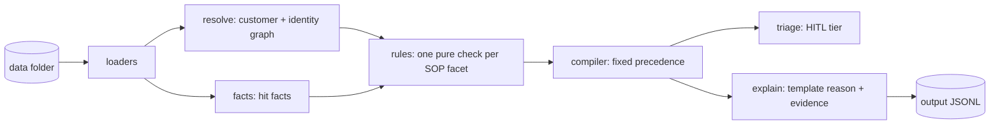

# Screening-hit adjudication engine

Entry point: `system/run <data folder> <output file>`. Python 3 standard library only. Reads only the given folder. Writes one JSON line per hit: `hit_id, alert_id, decision, reason_code, customer_record_id, reason, evidence`.

## Architecture

| Stage | File | Job |
|---|---|---|
| Load | `screening/loaders.py` | parse JSONL, index by ID, keep unknown columns |
| Resolve | `screening/resolve.py` | find the customer behind the alert |
| Facts | `screening/facts.py` | collect the hit's names, DOBs, countries, dates |
| Rules | `screening/rules/*.py` | each returns contradiction / agreement / neutral with evidence |
| Compile | `screening/compiler.py` | contradiction clears; agreement confirms; else REVIEW |
| Triage | `screening/triage.py` | AUTO_CLEAR / AUTO_ESCALATE / BORDERLINE / HUMAN_REVIEW |
| Explain | `screening/explain.py` | 2-4 sentence reason from rule summaries, sorted evidence IDs |

## How the customer side is resolved

1. Follow the alert's link (account ref, login handle, email) to customer records. *(implemented)*
2. Attach approved KYC checks via onboarding, newest first, and notes by requester email. *(implemented)*
3. Without a link, search records whose name / DOB / country / city fit the screened details. *(in progress)*
4. Identity graph: merge records sharing phone + full DOB, or the same document number on approved checks, transitively. *(in progress)*
5. Several persons fit -> decide per person; disagreement -> REVIEW / `AMBIGUOUS_CUSTOMER_RECORD`. *(implemented in compiler)*

The latest approved identity check outranks the customer record and the screened name.

## How the hit side is resolved

Names and aliases; DOBs from `dobs`; countries from `countries`, `nationality`, `citizenship`, last part of each address, `place_of_birth`; date of death. *(implemented)* Profile-note DOBs and ages-at-date, dated reports, and search results that match the hit's listing kind and country. *(in progress)*

## How evidence is represented

- Each rule emits a `RuleResult`: `rule_id` (SOP principle + facet, e.g. `P6.dob`), signal, one-sentence summary, the record IDs it used, and a weak flag.
- Output `evidence` = only the IDs of the results that decided the hit plus the resolved customer record, sorted.
- `--trace FILE` writes the full trail (tier, flags, every rule result) for audit and the dashboard; `screen explain <hit>` prints it.

## How runs stay identical

- No randomness, network, clock or LLM in decisions; stdlib only.
- Records read in file order; all listings and hits sorted by ID; template reasons; fixed key order; `\n` endings.
- Any exception -> REVIEW, so a crash cannot flip a decision.
- `python system/screen.py repro --data <folder> --runs 5` runs 5 fresh processes with different `PYTHONHASHSEED` and checks SHA-256 identity. Result: *to fill on final run*.

## Models and prompts

None in the decision path. The scored output is produced by deterministic rules. An LLM (Grok via OpenRouter) is used only outside `system/`: coding agents, an optional narrative in the demo dashboard, and a daily health-check bot.

## Time and cost per run

| Metric | Dev set | Notes |
|---|---|---|
| Wall time | *to fill* | single process, stdlib |
| Memory | *to fill* | |
| API cost | $0 | no API calls |

## Decision logic (summary)

1. Any contradiction (type, deceased, temporal, DOB, name, location) -> `DIFFERENT_ENTITY`, highest-priority reason. A location-only difference never clears a hit whose name and DOB agree -> `REVIEW`.
2. Person: name + DOB agree -> `SAME_ENTITY`. Company: name + country agree -> `SAME_ENTITY`.
3. Otherwise -> `REVIEW` / `INSUFFICIENT_DATA`.

## Worked examples

*To be filled from `python system/screen.py explain <hit> --data data/dev` once rules land. Use synthetic or paraphrased values; never paste data-room records.*

### Clear mismatch (DIFFERENT_ENTITY)

- Hit: *tbd* - Reason code: *tbd*
- Trace: *tbd*
- Output reason: *tbd*

### Match (SAME_ENTITY)

- Hit: *tbd* - Reason code: *tbd*
- Trace: *tbd*
- Output reason: *tbd*

### Review (REVIEW)

- Hit: *tbd* - Reason code: *tbd*
- Trace: *tbd*
- Output reason: *tbd*

## Results on dev

| Metric | Value |
|---|---|
| Decision score (cost saved vs all-REVIEW) | *to fill* |
| Reason-code accuracy | *to fill* |
| Unsafe clearances | *to fill* (must be 0) |
| Reproducibility over 5 runs | *to fill* |
